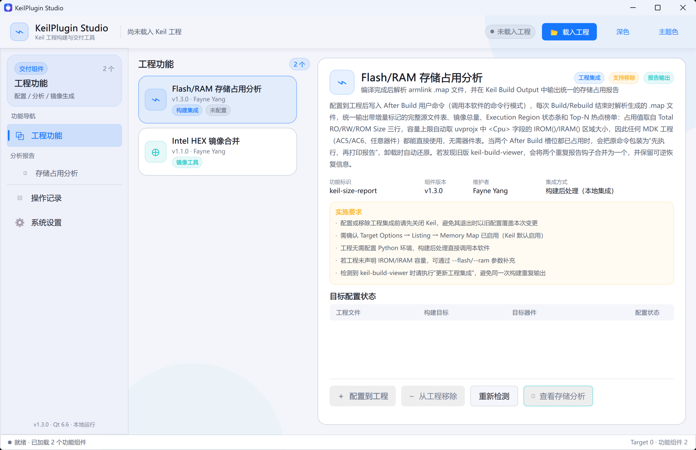
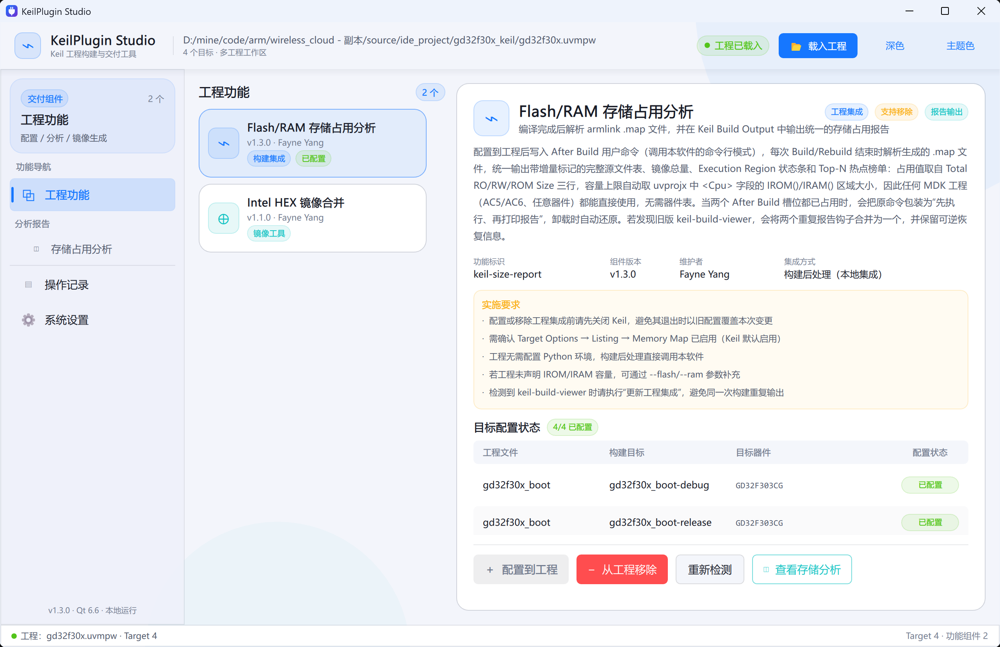
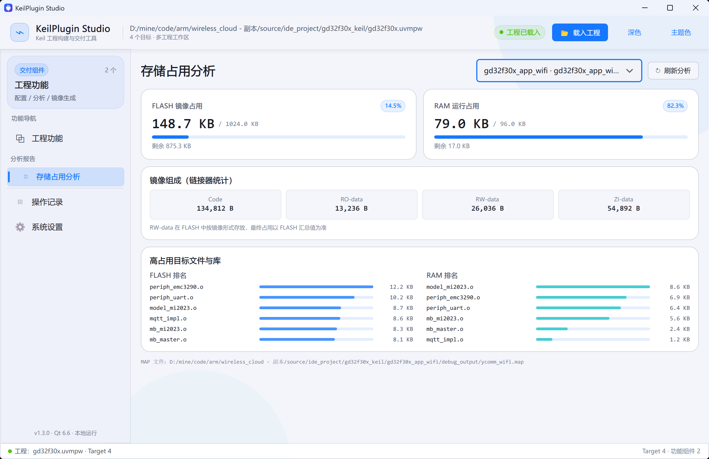
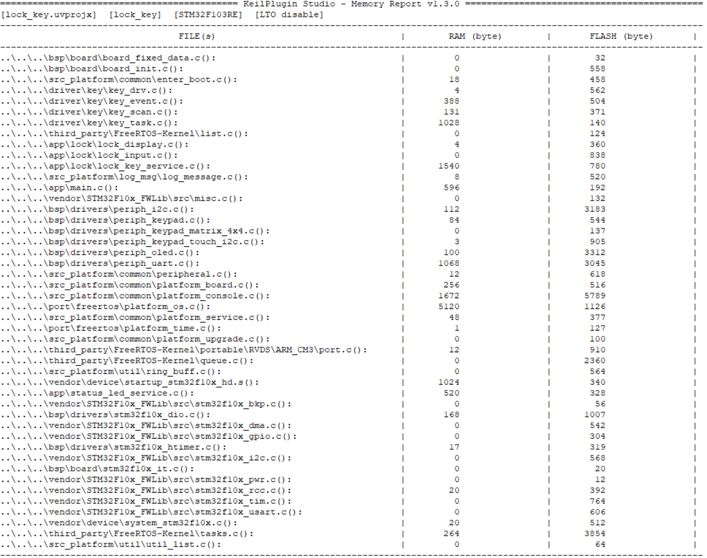
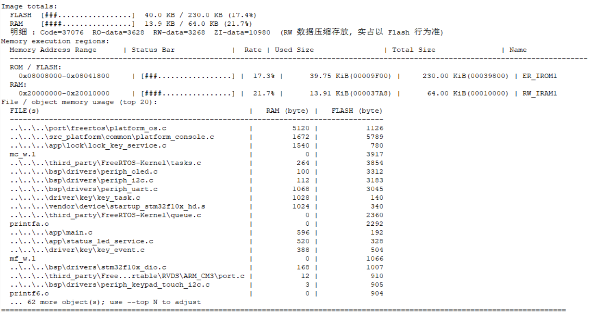

# KeilPlugin Studio

[中文文档](README_zh-CN.md) | **English**

KeilPlugin Studio is a Windows build-assistance and delivery tool for Keil MDK and NovoStudio GNU Arm projects. It produces unified FLASH/RAM reports from armlink MAP or GNU MAP + ELF files and merges Bootloader and application Intel HEX images.

Built with Qt 6 / Qt Quick / C++17, the release package contains the required Qt and compiler runtime libraries. The target PC does not need Qt, Python, or an external script environment.

## 1. Delivery Information

| Item | Description |
| --- | --- |
| Version | v1.4.0 |
| Delivery status | Release |
| Platform | Windows x64 |
| Supported inputs | Keil `.uvprojx` / `.uvmpw`; NovoStudio `.cproject` / `.project` / `.novoproject`; project directories |
| Compiler output | Arm Compiler 5 / 6 armlink MAP; GNU Arm MAP + little-endian ELF32 |
| Operation | GUI, Keil After Build and NovoStudio Post-build CLI |
| Distribution directory | `dist\\KeilPluginStudio` |
| Application | `dist\\KeilPluginStudio\\KeilPluginStudio.exe` |
| Dependencies | No Python dependency; Qt runtime is bundled |

When copying or delivering the application, keep the whole `dist\\KeilPluginStudio` directory. Do not copy only the EXE.

## 2. Included Components

- **Project Tools** — loads Keil / NovoStudio projects and detects build configurations, devices, output directories, memory capacities, MAP paths, and integration state.
- **Flash/RAM Memory Analysis** — parses armlink MAP or GNU Arm MAP + ELF files, prints a unified IDE build report, and displays totals, linker composition, and independent Flash/RAM rankings in the GUI.
- **Intel HEX Image Merge** — validates and merges Bootloader and application HEX images into a production programming image.
- **Activity Log** — records project loading, integration, removal, refresh, and tool results.
- **Settings** — selects light/dark appearance, accent color, and English/Chinese UI language.

The tool does not modify firmware source, Scatter/LD files, linker options, or device settings. Integration changes only After Build commands in `.uvprojx` or Post-build commands in `.cproject` files.

### NovoStudio integration (new in v1.4.0)

1. Close NovoStudio so cached settings cannot overwrite the change.
2. Run the distributed EXE and load the project's `.cproject` (or `.project` / `.novoproject`).
3. Configure **Flash/RAM Memory Analysis**. A report command is appended to each build configuration, preserving existing BIN export and disassembly steps.
4. Reopen NovoStudio and Build/Rebuild. The console shows the same file table, deltas, totals, region bars and Top-N report as Keil.
5. Refresh the GUI to review the output. A configuration with an existing MAP is selected initially.

The first write creates `.cproject.keilpluginstudio.bak`. Removal deletes only the generated report command. Update integration after changing language or moving the executable. The hook uses `${BuildArtifactFileName}` and `${ConfigName}`, so each build reports its own configuration. Debug/Release delta histories are stored separately in `.keilpluginstudio-memory-<configuration>-<artifact>.json`.

GNU reports require matching, adjacent `.map` and `.elf` files. Missing ELF or inconsistent section information produces an error. Enable MAP generation in the IDE if needed; this application does not change linker options. For custom paths use:

```bat
KeilPluginStudio.exe --size-report "Release\firmware.elf" --project ".cproject" --target Release --lang en
KeilPluginStudio.exe --size-report "custom.map" --elf "firmware.elf" --flash 256K --ram 128K
KeilPluginStudio.exe --install-novo ".cproject" --lang en
KeilPluginStudio.exe --remove-novo ".cproject"
```

The GUI supports standard GNU Arm managed-build configurations and artifact names. Unresolved custom path macros are rejected. Standalone MAP reports do not store project history.

The build report displays file usage, deltas, image totals, composition, memory regions and hotspots. The GUI uses the heading **RAM runtime usage**. Version 1.4.0 removes the extra explanatory notices while retaining the same calculations. Accounting details are documented in section 5.

Validated on 2026-11-02 using a separate copy of `PV_Inverter_Code_RT7P65`, NovoStudio's CDT builder and bundled GNU Arm toolchain. A full Release rebuild printed the report automatically: **139,312 / 262,143 B Flash (53.1%)**, **131,292 / 397,312 B RAM (33.0%)**. Build result: zero errors and one existing firmware warning about `main`'s return type. The original project configuration and sources were unchanged.

References: [GNU ld LMA/VMA](https://www.sourceware.org/binutils/docs/ld/Output-Section-LMA.html), [Eclipse CDT Build Steps](https://help.eclipse.org/latest/topic/org.eclipse.cdt.doc.user/reference/cdt_u_prop_build_settings_steps.htm). The existing Keil screenshots below illustrate the shared report layout.

### 2.1 User Interface

The Project Tools page shows installed components, requirements, and project integration state before a project is loaded.



After a Keil / NovoStudio project is loaded, the application shows its build configurations, devices, and integration state. Configuring or removing integration applies to all configurations in the loaded project files.



The Memory Analysis page shows FLASH/RAM totals, linker composition, and the largest object files and libraries for the selected Target.



The project paths, Target names, and usage values in these screenshots are examples only; actual values come from the loaded project and its latest armlink MAP or GNU Arm MAP + ELF files.

## 3. Language Selection

### 3.1 README language

This file is the English README. Use the link at the top to switch to [中文文档](README_zh-CN.md). Both documents are kept in the repository so Gitee and GitHub can render them directly.

### 3.2 Application language

The GUI defaults to English. Open **Settings → Language** and select **English** or **中文**. The choice takes effect immediately and is saved locally for the next launch.

When Flash/RAM Memory Analysis is configured, the selected language is stored in its Keil After Build / NovoStudio Post-build command (`--lang en` or `--lang zh-CN`). Build reports use that language, even on another machine. After changing the language for an already integrated project, choose **Update Project Integration**. NovoStudio Chinese reports use UTF-8 output.

## 4. Requirements Before Use

1. Use Windows x64; Windows 10 or Windows 11 is recommended.
2. The project directory and its `.uvprojx` / `.cproject` files must be writable.
3. Enable **Target Options → Listing → Memory Map** in Keil; for NovoStudio, generate matching MAP and ELF files for the selected configuration.
4. Build at least once before opening the memory report page.
5. Close the corresponding Keil / NovoStudio IDE before configuring or removing project integration.

The IDE caches project settings while a project is open and may overwrite external edits when it exits.

## 5. Memory Report

Version 1.4.0 prints one unified report after a Keil / NovoStudio build. It includes:

1. Project, Target, device, and LTO state;
2. a complete FILE(s) RAM/FLASH table;
3. Image totals;
4. Memory execution regions;
5. File/object memory usage (Top-N).

### 5.1 Complete file usage table

For Keil, the report lists linked objects in linker Object Name order and shows their RAM and FLASH bytes. When an object can be uniquely matched to a source file in `.uvprojx`, the project-relative source path is shown. NovoStudio aggregates objects and archive members in GNU MAP order; `[linker: ...]` rows identify generated tables, padding or reserved regions.

The following Keil screenshots were captured with v1.3.0 and illustrate the layout retained in v1.4.0.



The saved build snapshot also enables change markers:

| Marker | Meaning |
| --- | --- |
| `[NEW]` | New object in the current build |
| `[+N]` | Increased by N bytes since the last build |
| `[-N]` | Decreased by N bytes since the last build |

History files are stored next to the project: `.keilpluginstudio-memory-<OutputName>.json` for Keil and `.keilpluginstudio-memory-<configuration>-<artifact>.json` for NovoStudio. Deleting a history file removes that configuration's delta baseline. Unchanged objects have no delta marker.

### 5.2 Image totals and execution regions

The unified report then prints image totals, execution regions, and the Top-N hotspot table. This avoids the duplicate RAM/FLASH summary that often appears when multiple independent After Build tools are used.



`RW-data` is stored in the FLASH image and copied to RAM during startup. Use the FLASH total for image occupancy and the RAM total for runtime occupancy.

GNU Arm uses MAP + ELF to distinguish load and execution addresses. RAM code, data, BSS and heap/stack reservations contribute to the corresponding usage; debug and discarded sections are excluded. Code/RO/RW follow ELF attributes, and ZI includes zero-initialized regions and heap/stack reservations. Capacity follows the project's linker allocation.

Execution regions are grouped as **ROM / FLASH**, **RAM**, or **OTHER**. Custom armlink regions such as ITCM, DTCM, CCM and external SRAM are retained; unclassified regions appear under **OTHER**. NovoStudio regions come from the GNU MEMORY table. Totals count overlapping addresses once, while each region row shows usage within its own range; overlapping rows cannot be summed.

The console defaults to 20 hotspot rows; `--top 0` hides only that table. The GUI ranks Flash and RAM independently, showing six entries in each list.

## 6. Project Integration and Safety

For a new Keil project, the tool prefers the second After Build slot. A typical command is:

```text
"C:\\...\\KeilPluginStudio.exe" --size-report "#L" --project "demo.uvprojx" --lang en
```

Integration behavior:

- A free After Build slot is used directly.
- If both slots are occupied, the original command runs first and the memory report runs afterward.
- Complex original commands are stored with Base64 metadata for safe restoration.
- Removing integration restores the original command.
- Legacy `keil_size_report.py` hooks are cleaned up.
- Existing `keil-build-viewer` hooks can be consolidated into one reversible report hook.

Before an `.uvprojx` file is written, XML validity is checked and UTF-8/ANSI encoding plus BOM state are preserved. For important projects, commit or back up the `.uvprojx` file before first integration.

NovoStudio appends the report to `.cproject` Post-build steps, preserving existing commands. It validates XML, creates `.cproject.keilpluginstudio.bak` on the first write, and saves atomically. Removal deletes the generated report command.

Both integrations record the absolute EXE path. If the distribution directory is moved or renamed, run the EXE from its new location and configure integration again.

## 7. MAP File Discovery

Keil MAP files may be placed in custom Listing or Output paths. Discovery priority is:

1. explicit `--map` command-line argument;
2. `--list=` path in uvprojx linker Misc controls;
3. `ListingPath/OutputName.map`;
4. `OutputDirectory/OutputName.map`;
5. the newest MAP in those directories;
6. bounded recursive search under the common project/output parent.

Recursive search is limited to four levels. Files matching `OutputName` are preferred, then the most recently modified MAP is chosen.

NovoStudio locates matching MAP / ELF files using the current configuration's build directory and artifact name. It does not select the newest file from a different configuration. Use `--map` / `--elf` for custom paths.

## 8. Command Line Interface

### 8.1 Memory report

```text
KeilPluginStudio.exe --size-report "#L" --project "<uvprojx>" --lang en|zh-CN [options]
KeilPluginStudio.exe --size-report "Release\firmware.elf" --project ".cproject" --target Release --lang en|zh-CN [options]
```

| Option | Description |
| --- | --- |
| `--project <path>` | `.uvprojx` / `.cproject` context for AXF / ELF inputs, including target and device |
| `--map <path>` | Explicit MAP path; highest priority |
| `--elf <path>` | Explicit companion ELF file for a GNU MAP |
| `--target <name>` | Select a build configuration, such as Debug / Release |
| `--top N` | Number of hotspot entries; default 20, 0 disables only this table |
| `--flash 230K` | Manual FLASH capacity when the project does not declare it |
| `--ram 64K` | Manual RAM capacity when the project does not declare it |
| `--lang en\|zh-CN` | Build Output report language; integration writes this automatically |
| `--quiet` | Prints one Flash/RAM summary line per target |

### 8.2 Internal wrapper commands

These commands are generated by project integration and normally do not need to be called manually:

```text
KeilPluginStudio.exe --wrap "<original command>" "#L" --project "<uvprojx>"
KeilPluginStudio.exe --wrap-b64 <base64> "#L" --project "<uvprojx>"
```

### 8.3 NovoStudio integration commands

Close NovoStudio before applying or removing integration:

```text
KeilPluginStudio.exe --install-novo ".cproject" --lang en|zh-CN
KeilPluginStudio.exe --remove-novo ".cproject"
```

### 8.4 GUI startup options

| Option | Description |
| --- | --- |
| `--project=<path>` | Load a project at startup |
| `--page=0..3` | Select the initial page |
| `--dark` | Start with the dark theme |

## 9. Intel HEX Merge

The image tool supports Intel HEX record types 00, 01, 02, 04, and 05. It validates inputs, checks record checksums and address overlap, then writes the requested output file. If it detects invalid data or an address conflict, the operation stops and no partial output file is produced.

## 10. Building from Source

Required environment:

- Qt 6.6.3 mingw_64;
- CMake 3.21 or later;
- Ninja;
- MinGW 11.2 64-bit;
- PowerShell.

Build and test:

```powershell
powershell -NoProfile -ExecutionPolicy Bypass -File scripts\\build.ps1 -RunTests
```

Create the self-contained release directory:

```powershell
powershell -NoProfile -ExecutionPolicy Bypass -File scripts\\package.ps1
```

## 11. Validation and Release Notes

The v1.4.0 Release build and core regression suite passed. NovoStudio checks covered:

- A full RT7P65 Release rebuild with automatic Post-build reporting: zero errors and one existing firmware warning.
- GNU MAP + ELF parsing, code executed in RAM, and overlapping address ranges.
- Rejection of missing/truncated ELF files and inconsistent MAP/ELF sections.
- Repeated installation, language updates and restoration of original post-build commands.
- UTF-8 Chinese output and removal of extra notices from both report languages.
- Configuration selector synchronization and independent Flash/RAM rankings.
- Matching build/distribution executables and synchronized English/Chinese READMEs.

Version 1.4.0 adds NovoStudio integration with separate Debug/Release reports and histories; `--target`, `--elf`, `--install-novo` and `--remove-novo`; UTF-8 GNU reports; and the simplified report/GUI presentation. The existing Keil integration remains available.

## 12. Acknowledgements

Special thanks to [MoodDream / keil-memory-bar](https://gitee.com/MoodDream/keil-memory-bar). Its public implementation informed the Execution Region parsing, ROM/RAM classification, and Build Output status-bar presentation used here.

KeilPlugin Studio extends those ideas with `.uvprojx` source-file association, complete RAM/FLASH object statistics, build deltas, multi-Target capacity context, Qt project configuration/status views, and reversible migration.
