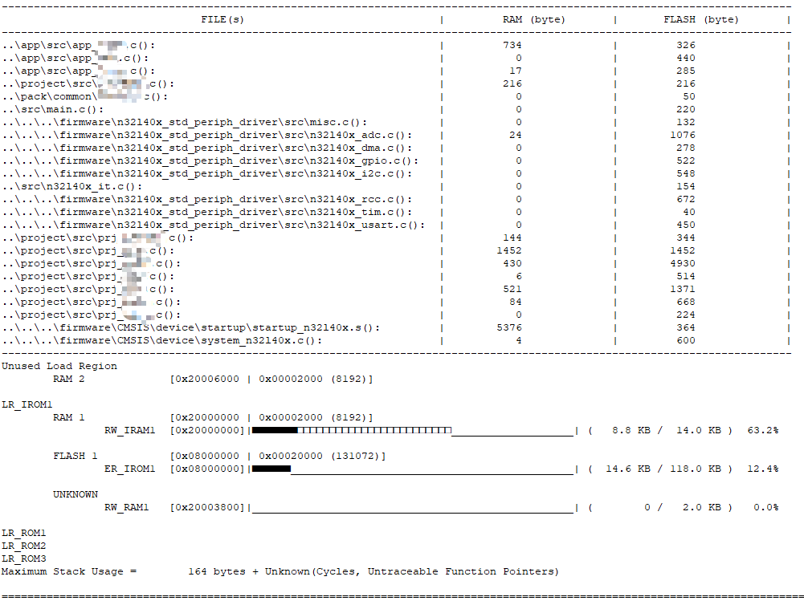

# KeilPlugin Studio

KeilPlugin Studio 是面向 Keil MDK 工程的 Windows 构建辅助与交付工具，用于统一生成
FLASH/RAM 存储占用报告，并完成 Bootloader 与应用程序 Intel HEX 镜像合并。

软件采用 Qt 6 / Qt Quick / C++17 实现，发布包已包含 Qt 运行库和编译器运行库。
目标计算机无需安装 Qt、Python 或其他脚本环境。

## 1. 交付信息

| 项目 | 说明 |
| --- | --- |
| 软件版本 | v1.3.0 |
| 交付状态 | Release |
| 目标平台 | Windows x64 |
| 支持工程 | Keil MDK 的 .uvprojx、.uvmpw 和工程目录 |
| 编译器范围 | Arm Compiler 5 / Arm Compiler 6 的 armlink MAP 输出 |
| 运行方式 | 图形界面 + Keil After Build 命令行模式 |
| 发布目录 | dist\KeilPluginStudio |
| 主程序 | dist\KeilPluginStudio\KeilPluginStudio.exe |
| 外部依赖 | 无 Python 依赖；发布目录已包含 Qt 运行库 |

交付或复制软件时，应保留 **dist\KeilPluginStudio** 整个目录，不要只复制 EXE。

## 2. 交付范围

本版本包含以下功能：

- **工程功能**：载入 Keil 工程，识别工程文件、Target、目标器件、输出目录、
  IROM/IRAM 容量、MAP 路径和工程集成状态。
- **Flash/RAM 存储占用分析**：解析 armlink MAP 文件，在 Keil Build Output
  中输出统一报告，并在 Qt 页面显示总体占用、组成明细和高占用目标文件。
- **Intel HEX 镜像合并**：校验并合并 Bootloader 与应用程序 HEX，生成出厂烧录镜像。
- **操作记录**：记录工程载入、配置、移除、状态刷新和工具执行结果。
- **系统设置**：配置浅色/深色主题、界面主色，并查看标准工程使用流程。

本工具不会修改固件源代码、Scatter 文件、链接参数或器件配置。只有在用户执行
“配置到工程”或“从工程移除”时，才会修改 .uvprojx 中的 After Build 用户命令。

## 3. 发布包结构

~~~text
dist/KeilPluginStudio/
├─ KeilPluginStudio.exe    主程序
├─ README.md               工程交付与使用说明
├─ Qt6*.dll                Qt 运行库
├─ lib*.dll                MinGW 运行库
├─ platforms/              Windows 平台插件
├─ qml/                    Qt Quick 运行组件
├─ imageformats/           图像格式插件
├─ translations/           Qt 翻译资源
└─ shots/                  功能效果截图
~~~

## 4. 使用前条件

使用前请确认：

1. 目标计算机为 Windows x64，建议使用 Windows 10 或 Windows 11。
2. Keil 工程目录和 .uvprojx 文件具有写权限。
3. Keil 已启用 Target Options → Listing → Memory Map，能够生成 MAP 文件。
4. 工程至少完成过一次 Build/Rebuild，便于界面直接读取最近一次 MAP。
5. 配置或移除工程集成前，必须先关闭 Keil。

Keil 在打开工程期间会把配置保留在内存中。若不关闭 Keil 就修改 .uvprojx，
Keil 退出时可能使用旧配置覆盖本软件写入的内容。

## 5. 标准使用流程

### 5.1 配置存储占用分析

1. 运行 **dist\KeilPluginStudio\KeilPluginStudio.exe**。
2. 点击“载入工程”，选择 .uvprojx 或 .uvmpw 文件。
3. 在“工程功能”页面核对工程文件、构建目标和目标器件。
4. 选择“Flash/RAM 存储占用分析”。
5. 确认 Keil 已关闭，点击“配置到工程”。
6. 重新打开 Keil，执行 Build 或 Rebuild。
7. 在 Keil Build Output 中检查统一存储报告。
8. 在本软件“存储占用分析”页面查看图形化结果。

如果检测到旧版 keil-build-viewer 与本软件同时存在，状态会显示“待更新”。
点击“更新工程集成”后，旧工具的重复输出会被停用，并由本软件一次生成统一报告。

### 5.2 从工程移除

1. 关闭 Keil。
2. 重新载入目标工程。
3. 选择“Flash/RAM 存储占用分析”。
4. 点击“从工程移除”并确认。
5. 检查操作记录，确认原 After Build 命令已恢复。

若工程曾迁移自 keil-build-viewer，本软件会使用保存的恢复信息还原原命令。

### 5.3 生成合并镜像

1. 在“工程功能”中选择“Intel HEX 镜像合并”。
2. 选择 Bootloader 镜像。
3. 选择应用程序镜像。
4. 指定输出镜像路径。
5. 点击“生成合并镜像”。
6. 检查操作记录和输出文件。

工具支持 Intel HEX Type 00、01、02、04、05 记录。检测到地址重叠、输入无效
或记录校验失败时会立即中止，不生成半成品输出文件。

## 6. 存储报告说明

每次 Build/Rebuild 完成后，Build Output 按以下顺序输出：

1. 工程、Target、器件和 LTO 状态。
2. 完整文件/目标文件 RAM、FLASH 占用表。
3. 镜像总量 Image totals。
4. Memory execution regions。
5. RAM/FLASH 高占用文件 Top-N。

### 6.1 文件增量标记

完整文件表会与上一次构建快照比较：

| 标记 | 含义 |
| --- | --- |
| [NEW] | 本次构建新增的文件或目标对象 |
| [+N] | 相比上一次构建增加 N 字节 |
| [-N] | 相比上一次构建减少 N 字节 |

历史快照保存在工程旁：

~~~text
.keilpluginstudio-memory-<OutputName>.json
~~~

删除该文件不会影响编译，但会丢失下一次报告的增量比较基线。首次迁移时，如果工程目录
存在 keil-build-viewer-record.txt，本软件会尝试使用其数据建立初始比较基线。

### 6.2 镜像总量

~~~text
Image totals:
FLASH  [#...................]  15.0 KB / 512.0 KB (2.9%)
RAM    [#...................]   6.4 KB /  96.0 KB (6.7%)
明细 : Code=14160  RO-data=896  RW-data=4984  ZI-data=1608
~~~

RW-data 会存放在 FLASH 镜像中，并在启动后复制到 RAM。FLASH 最终占用应以
FLASH 汇总行和链接器总量为准。

### 6.3 Execution Region

报告会解析 MAP 中的 Execution Region，并列出：

- 起止地址；
- 使用率和状态条；
- 已用容量与总容量；
- 区域名称；
- ROM/FLASH、RAM 和无法仅按地址判定的 UNKNOWN 区域。

ER_ITCM 等区域即使归入 UNKNOWN，也会保留在报告中，不会被过滤。

### 6.4 文件占用统计

源文件路径能够与 .uvprojx 的 FilePath 唯一对应时，报告优先显示工程相对路径；
无法唯一关联时显示目标文件或库成员名称。

## 7. 工程变更与安全边界

| 操作 | 修改对象 | 可恢复性 |
| --- | --- | --- |
| 载入工程 | 只读解析工程、Target 和 MAP | 不产生工程变更 |
| 刷新分析 | 只读重新解析工程与 MAP | 不产生工程变更 |
| 配置到工程 | 修改 .uvprojx 的 AfterMake 用户命令 | 可通过“从工程移除”恢复 |
| 更新工程集成 | 合并旧内存报告命令，避免重复输出 | 保存旧命令恢复信息 |
| 从工程移除 | 移除本软件命令并恢复被包装命令 | 恢复至配置前命令 |
| 合并镜像 | 写入用户指定的输出 HEX | 不修改 Keil 工程 |

写回 .uvprojx 前会进行 XML 合法性检查，并保留原文件的 UTF-8/ANSI 编码和 BOM 状态。
由于工程文件属于关键配置，仍建议在首次配置前提交版本控制或单独备份 .uvprojx。

After Build 命令记录的是配置时的 EXE 绝对路径。移动或重命名发布目录后，应使用新位置
的 KeilPluginStudio.exe 重新配置工程集成。

## 8. After Build 集成原理

新工程优先使用 AfterMake slot2，典型命令如下：

~~~text
"C:\...\KeilPluginStudio.exe" --size-report "#L" --project "demo.uvprojx"
~~~

处理规则：

- 空闲槽位存在时，直接写入本软件命令。
- 两个槽位都已使用时，包装原命令，先执行原命令，再输出存储报告。
- 原命令包含复杂引号时，使用 Base64 元数据保存和恢复，避免命令行转义破坏。
- 移除集成时解开包装并恢复原命令。
- 支持清理旧版 keil_size_report.py 钩子。
- 检测到 keil-build-viewer 时合并重复报告，并保留可逆恢复信息。

## 9. MAP 文件定位规则

MAP 文件允许位于自定义 Listing 或 Output 目录。软件按以下优先级查找：

1. 命令行 **--map** 明确指定的 MAP；
2. .uvprojx Linker Misc controls 中的 **--list=** 路径；
3. **ListingPath/OutputName.map**；
4. **OutputDirectory/OutputName.map**；
5. 上述目录中修改时间最新的 MAP；
6. 工程目录与输出目录公共上级内的有界递归搜索。

递归搜索最大深度为 4 层，优先匹配 OutputName，其次选择最新修改文件。

## 10. 命令行接口

### 10.1 存储报告

~~~text
KeilPluginStudio.exe --size-report "#L" --project "<uvprojx>" [options]
~~~

| 参数 | 说明 |
| --- | --- |
| --project <path> | 指定 uvprojx，用于恢复 Target、器件和 IROM/IRAM 上下文 |
| --map <path> | 明确指定 MAP 文件，优先级最高 |
| --top N | 设置热点榜单行数，默认 20；0 表示关闭热点榜单 |
| --flash 230K | 工程未声明容量时手工指定 FLASH 容量 |
| --ram 64K | 工程未声明容量时手工指定 RAM 容量 |
| --quiet | 仅执行解析，不打印完整报告 |

**--top** 只控制末尾热点榜单，不影响完整文件增量表和 Execution Region 表。

### 10.2 内部包装入口

以下入口由工程集成自动生成，一般无需手工调用：

~~~text
KeilPluginStudio.exe --wrap "<原命令>" "#L" --project "<uvprojx>"
KeilPluginStudio.exe --wrap-b64 <base64> "#L" --project "<uvprojx>"
~~~

### 10.3 GUI 启动参数

| 参数 | 说明 |
| --- | --- |
| --project=<path> | 启动后自动载入工程 |
| --page=0..3 | 启动后打开指定页面 |
| --dark | 使用深色主题启动 |

## 11. 常见问题

| 现象 | 检查与处理 |
| --- | --- |
| 找不到 MAP 文件 | 先在 Keil 编译一次，确认 Listing → Memory Map 已启用，并检查 Listing/Output 路径 |
| Build Output 没有报告 | 检查工程配置状态，并确认 After Build 中记录的 EXE 路径仍然有效 |
| 一次构建出现两份占用报告 | 关闭 Keil，在本软件中执行“更新工程集成” |
| 配置后重新打开工程发现修改丢失 | 配置时 Keil 未关闭；关闭 Keil 后重新配置 |
| FLASH/RAM 总容量为空 | 检查 .uvprojx 的 IROM/IRAM 配置，或使用 --flash/--ram |
| 增量标记消失 | 检查工程旁的 .keilpluginstudio-memory-*.json 是否被删除 |
| HEX 合并失败 | 检查记录校验、地址范围、输入文件完整性以及输出目录写权限 |
| 移动软件后报告无法执行 | 从新目录运行 EXE，并重新配置工程集成 |

## 12. 交付验收

当前 v1.3.0 已完成以下验证：

| 验收项 | 结果 |
| --- | --- |
| Windows x64 Release 编译 | 通过 |
| QML 四个常驻页面启动检查 | 通过 |
| KeilPluginCoreTest | 1/1 通过 |
| 真实 GD32 AC6 MAP 回归 | 通过 |
| 完整文件增量、Image totals、Execution Region、Top-N | 通过 |
| ER_ITCM/UNKNOWN 区域保留 | 通过 |
| keil-build-viewer 合并及移除恢复 | 通过 |
| Intel HEX 地址重叠保护 | 通过 |
| 自包含发布目录打包 | 通过 |

建议现场验收至少完成：

1. 载入实际工程并核对全部 Target。
2. 配置工程集成并执行两次连续 Build。
3. 确认第二次报告能够显示增量标记。
4. 检查 FLASH/RAM 总量与 Keil Program Size。
5. 检查各 Execution Region，特别是 ITCM、CCM 或自定义区域。
6. 从工程移除并确认原 After Build 命令恢复。

## 13. 源码构建与发布

### 13.1 构建环境

- Qt 6.6.3 mingw_64；
- CMake 3.21 或更高；
- Ninja；
- MinGW 11.2 64-bit；
- PowerShell。

### 13.2 Release 构建与测试

~~~powershell
powershell -NoProfile -ExecutionPolicy Bypass -File scripts\build.ps1 -RunTests
~~~

构建脚本会：

1. 定位本机 Qt、CMake、Ninja 和 MinGW；
2. 生成 Release；
3. 部署构建目录运行库；
4. 按需执行核心测试；
5. 同步 EXE、README 和截图到发布目录。

若 **build/CMakeCache.txt** 来自工程搬迁前的位置，脚本不会删除旧缓存，而是自动使用
**build-local** 完成当前目录构建。

### 13.3 自包含发布

~~~powershell
powershell -NoProfile -ExecutionPolicy Bypass -File scripts\package.ps1
~~~

发布脚本会先构建最新源码，再向 **dist\KeilPluginStudio** 部署 Qt 和编译器运行库。

## 14. 源码目录

~~~text
src/
  main.cpp           GUI/CLI 入口、统一报告输出、历史快照
  keilproject.*      uvprojx/uvmpw、Target、容量和 MAP 定位
  uvprojxhook.*      After Build 配置、迁移、包装与恢复
  mapparser.*        armlink MAP、对象表和 Execution Region 解析
  hexmerger.*        Intel HEX 解析、重叠校验与输出
  keilplugin.*       功能组件抽象接口
  builtinplugins.*   存储分析与 HEX 合并功能定义
  pluginregistry.*   功能组件注册
  pluginmanager.*    工程、报告、工具和操作记录 QML 接口
  windowchrome.*     Windows DWM 标题栏适配
qml/
  Main.qml           主窗口、导航、状态栏、主题和 Toast
  Theme.qml          浅色/深色主题令牌
  components/        通用按钮、卡片、下拉框、导航和状态组件
  dialogs/           工程变更确认弹窗
  pages/             工程功能、存储占用分析、操作记录、系统设置
scripts/             构建、打包和 Qt 工具链定位脚本
tests/               KeilPluginCoreTest
shots/               README 功能截图
dist/                自包含发布目录
~~~

## 15. 二次开发接口

界面由功能组件元数据驱动。新增功能时：

1. 派生 **KeilPlugin**。
2. 在 **PluginDescriptor** 中声明名称、版本、能力、说明和实施要求。
3. 工程集成功能实现 targetInstalled、installProject、uninstallProject。
4. 本地工具实现 runTool。
5. 在 PluginRegistry 中注册。

~~~cpp
PluginRegistry::instance().registerPlugin(new MyPlugin);
~~~

新增功能应继续遵守现有工程变更确认、可恢复性、操作记录和深浅主题规范。

## 16. 版本更新摘要

v1.3.0 主要更新：

- 将 Qt 页面统一为工程交付语言：工程功能、工程集成、存储占用分析、操作记录和系统设置。
- 将结果通知居中显示，避免遮挡页面底部操作按钮。
- 统一 Build Output 报告，避免文件占用和内存区域重复输出。
- 增加完整文件增量、Image totals、Execution Region 和 Top-N 组合报告。
- 保留 ER_ITCM 等 UNKNOWN 执行区域。
- 支持从 keil-build-viewer 迁移并可逆恢复。
- 加固工程搬迁后的构建和发布流程。

## 17. 特别鸣谢

特别感谢 [MoodDream / keil-memory-bar](https://gitee.com/MoodDream/keil-memory-bar)。

本项目的 Execution Region 解析、ROM/RAM 分类及 Build Output 状态条改进，
参考了该项目公开实现提供的思路。在此基础上，KeilPlugin Studio 进一步实现了：

- .uvprojx 源文件路径关联；
- 完整 RAM/FLASH 文件统计与构建增量；
- 多 Target 容量上下文；
- 统一 Image totals、Execution Region 和 Top-N 输出；
- Qt 工程配置、状态查看和可逆迁移流程。
