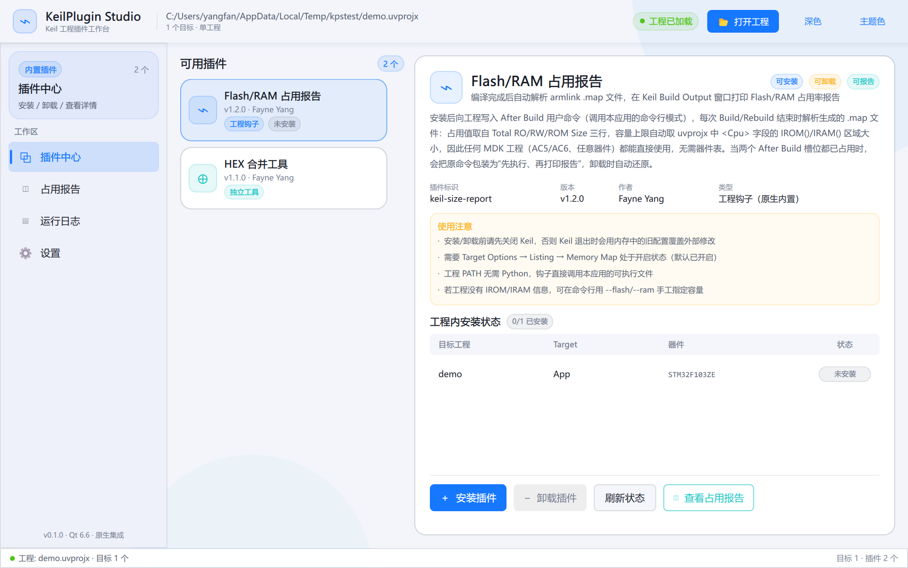

# KeilPlugin Studio

Keil MDK 工程的插件工作台 —— 用 Qt 6 / Qt Quick 原生实现的插件管理器。初版内置
**Flash/RAM 占用报告** 插件：向所选 Keil 工程写入 After Build 钩子，每次
Build/Rebuild 后自动在 Keil 的 Build Output 窗口打印 Flash/RAM 占用率报告；
另内置 **HEX 合并工具**（Bootloader + App 出厂镜像合并）演示独立工具类插件。

整个应用**原生 C++，无 Python 依赖**。参考的 Python 脚本（keil_size_report.py /
merge_hex.py）的逻辑已被完整移植为 C++（工程解析、钩子补丁、map 解析、HEX 合并）。



## 功能

- **插件中心**：插件列表 + 详情（版本 / 能力 / 描述 / 使用注意）；工程钩子类插件提供
  安装、卸载、按 Target 的安装状态表；独立工具类插件提供操作面板。
- **插件报告**（侧边栏子菜单）：由插件元数据自动生成——插件在 descriptor 里声明
  `viewLabel` 并登记页索引后，会作为“插件中心 → 插件报告”下的子项出现，
  不同插件各自拥有独立的报告/输出页面。内置“Flash/RAM 占用报告”解析 armlink
  `.map`，按 Target 展示 Flash/RAM 占用（进度条 + 90% 预警）、Code/RO/RW/ZI
  段明细、占用最大的目标文件（Top ROM / Top RAM）。
- **运行日志**：所有安装/卸载/加载/工具操作的分级日志。
- **设置**：浅色 / 深色主题、六色主色令牌、插件扩展说明。

### 钩子安装原理（与参考 Python 工具一致）

- 写入 uvprojx 的 `<AfterMake>` 用户命令槽位（优先 slot2），命令形如：

  ```
  "C:\...\KeilPluginStudio.exe" --size-report "demo.uvprojx"
  ```

- 两个槽位都被占用时，把原命令包装为 `--wrap "原命令" "demo.uvprojx"`
  （先执行原命令、再打印报告）；卸载时自动解包还原，也支持清理旧版
  `keil_size_report.py` Python 钩子。
- 写回前做 XML 合法性校验；保留原文件编码（UTF-8 / ANSI）与 BOM。
- 容量上限自动取 `<Cpu>` 字段的 `IROM()/IRAM()` 区域大小，任意器件通用。

### 命令行模式（Keil 钩子调用入口）

```text
KeilPluginStudio.exe --size-report "#L" --project "<uvprojx>" [--top N] [--flash 230K] [--ram 64K] [--quiet]
KeilPluginStudio.exe --wrap "原命令" "#L" --project "<uvprojx>"        # 内部：先执行原命令再打印报告
KeilPluginStudio.exe --wrap-b64 <base64> "#L" --project "<uvprojx>"    # 内部：同上，原命令含引号时使用
```

说明：
- `#L` 由 Keil 展开为当前 Target 的 .axf，因此每个 Target 只报告自己；
  `--project` 提供器件与 IROM/IRAM 容量上下文。
- 含双引号的原命令无法直接包装（Keil 直接 CreateProcess 执行命令行），
  会自动改为 base64 包装，运行时由本应用解码、展开 `$L/@L/#L` 变量后经 cmd 执行。
- 主程序为 GUI 子系统（不弹控制台）；命令行模式的输出需重定向才能看到，
  例如 `KeilPluginStudio.exe --size-report demo.uvprojx > report.txt`。
- 钩子由 Keil 调用时自带重定向，输出照常进入 Build Output 窗口。

### .map 文件查找顺序

Output/Listing 目录只是工程里两个常见位置，map 实际允许放在任意自定义
目录（Linker 的 Misc controls `--list=`、Listing 目录自定义等）。查找按
固定顺序进行，命中即停：

1. `--map <map文件>` 显式指定（最高优先级，覆盖一切自动猜测）；
2. uvprojx 链接器 Misc controls 里的 `--list=` 覆盖路径；
3. `<ListingPath>/<OutputName>.map`，其次 `<OutputDirectory>/<OutputName>.map`
   （相对 uvprojx 所在目录解析，任意层级均可）；
4. 上述目录内"最新的 *.map"；
5. 工程目录与 Output/Listing 的公共上级目录内有界递归搜索
   （限深 4 层，优先文件名匹配 OutputName 的 map，其次最新修改）。

仍未命中时，Build Output 会列出已查找的位置：若 Target 未勾选
Linker Listing（AdsLmap=0）会明确提示 Keil 根本不会生成 map；也可临时在
钩子命令里追加 `--map "<绝对路径>\xxx.map"` 兜底。

GUI 附加启动参数：`--project=<路径>`（启动即加载工程）、`--page=0..3`、`--dark`。

## 构建与发布

环境：Qt 6.6.3 mingw_64 + CMake + Ninja（与 PowerConfig Studio 相同工具链）。

```powershell
# 日常构建：编译 + 部署 Qt 运行时到 build exe 旁 + 自动同步 dist（-RunTests 跑单元测试）
powershell -NoProfile -ExecutionPolicy Bypass -File scripts\build.ps1 -RunTests

# 发布打包：把 exe/README 复制到 dist\KeilPluginStudio 并部署 Qt 运行时，
# 产出自包含文件夹，拷到任何机器（无需 Qt/开发环境）即可运行
powershell -NoProfile -ExecutionPolicy Bypass -File scripts\package.ps1
```

`dist\KeilPluginStudio\` 由 CMake 构建后自动同步 exe；package.ps1 额外部署
Qt 运行时与编译器运行库。注意：插件钩子记录的是"安装时"的 exe 路径——
如果确定以 dist 作为日常使用位置，请在 dist 的 exe 上重新安装一次插件。

运行（开发环境）：

```powershell
$env:PATH = "E:\QT\Tools\mingw1120_64\bin;E:\QT\6.6.3\mingw_64\bin;$env:PATH"
.\build\KeilPluginStudio.exe
```

## 新增插件（预留的扩展点）

界面完全由插件元数据驱动，新增插件**不需要改任何 UI 代码**：

1. 派生 `KeilPlugin`（见 `src/keilplugin.h`），在 `PluginDescriptor` 里声明
   名称 / 版本 / 能力（`install` `uninstall` `report` `run`）/ 使用注意；
2. 按需覆写 `targetInstalled` / `installProject` / `uninstallProject`（工程钩子类）
   或 `runTool`（独立工具类）；
3. 在 `PluginRegistry::PluginRegistry()`（`src/pluginregistry.cpp`）里注册一行：

```cpp
PluginRegistry::instance().registerPlugin(new MyPlugin);
```

插件中心会自动渲染新插件的列表卡片、详情页与操作按钮（参考 `src/builtinplugins.cpp`
中两个内置插件的写法）。

## 目录结构

```text
src/
  main.cpp           GUI 与 CLI（--size-report / --wrap）入口
  keilproject.*      uvprojx/uvmpw/目录解析、目标/容量/map 发现、编码兼容
  uvprojxhook.*      After Build 钩子安装/卸载/解包（含旧版 Python 钩子清理）
  mapparser.*        armlink .map 解析（Total RO/RW/ROM、Grand Totals、组件聚合）
  hexmerger.*        Intel HEX 合并（重叠校验、线性地址输出）
  keilplugin.*       插件抽象基类与描述符
  builtinplugins.*   内置插件：Flash/RAM 占用报告、HEX 合并工具
  pluginregistry.*   插件注册表（扩展点）
  pluginmanager.*    QML 门面：工程加载、安装/卸载、报告数据、日志
  windowchrome.*     DWM 原生标题栏融合
qml/
  Main.qml           主窗口（头部/侧边导航/状态栏/主题面板/Toast）
  Theme.qml          设计令牌（与 PowerConfig Studio 同源）
  components/        AppButton / AppCard / AppComboBox / NavItem / StatusPill / 空态
  dialogs/           风险分级确认弹窗
  pages/             插件中心 / 占用报告 / 运行日志 / 设置
tests/               KeilPluginCoreTest 单元测试
```

界面设计令牌（颜色 / 圆角 / 动效 / 字号）与 PowerConfig Studio 保持一致，
深浅两主题对等，安装与卸载操作均有二次确认弹窗。
