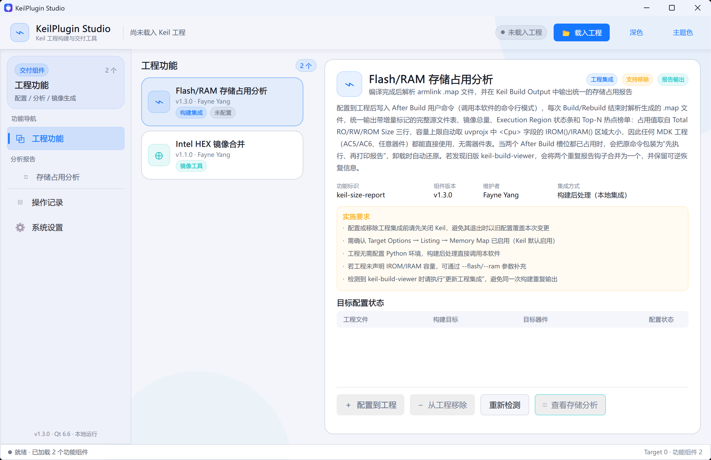
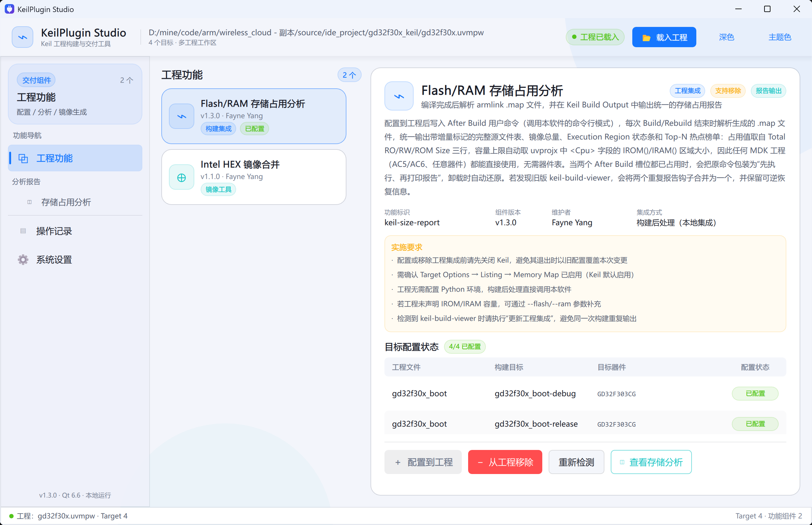
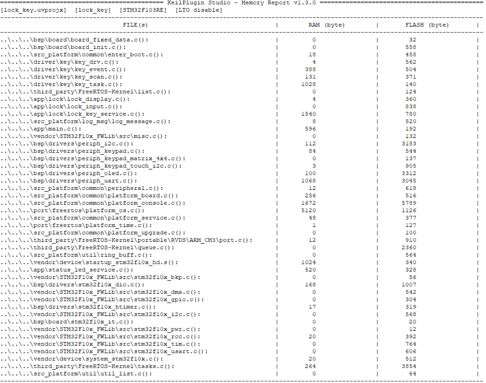
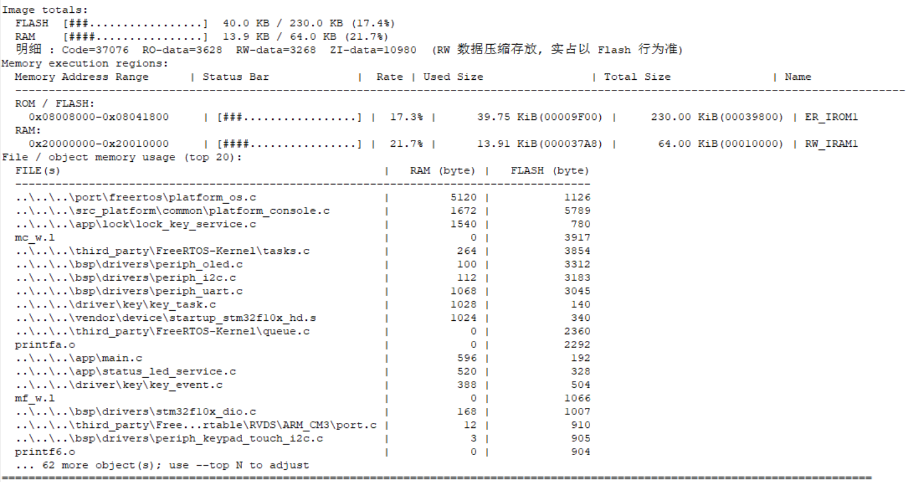
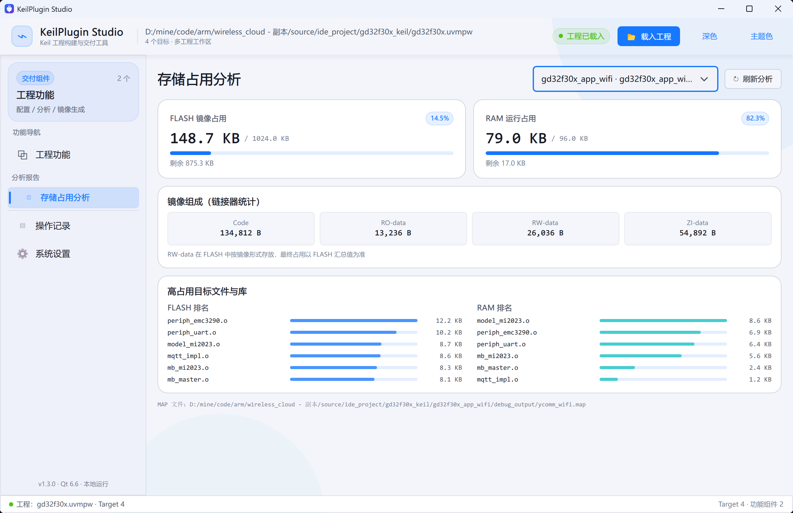

# KeilPlugin Studio：把 Keil 的存储分析和交付流程收拢到一起

做 Keil 工程久了，大家应该都遇到过这种情况：编译能过，Program Size 也有，但真要看“哪个文件变大了”“RAM 到底被谁吃掉了”“ITCM 这块算不算进去”，又得翻 MAP、跑脚本、看几份不同格式的输出。

KeilPlugin Studio 就是为这件事做的一个小工具。它不是替代 Keil，而是把构建后的存储分析、工程集成和 HEX 镜像合并这些零散操作，收在一个 Windows 工具里。

## 1. 工具目前做什么

### 1.1 两个核心功能

当前版本提供两个功能组件：

- Flash/RAM 存储占用分析；
- Intel HEX 镜像合并。

前者会解析 Keil 编译后生成的 armlink MAP 文件，并把报告直接打到 Keil 的 Build Output 里；后者用于合并 Bootloader 和应用程序的 HEX 文件，生成最终烧录镜像。



### 1.2 工程集成不改源码

工具载入 `.uvprojx`、`.uvmpw` 或工程目录后，会识别 Target、器件、输出目录、MAP 路径和 IROM/IRAM 容量。

它不会动源码、Scatter 文件或链接参数。需要写入工程的地方只有 After Build 用户命令，而且“配置到工程”和“从工程移除”都是可逆的。



## 2. 为什么做统一存储报告

### 2.1 不想再看两套重复的 RAM/FLASH 数据

以前我试过把文件占用统计和内存条形图工具一起挂到 After Build。信息确实多，但 Keil 输出窗口里会出现两份 RAM/ROM 结果：一份按文件统计，一份按 Region 统计。看久了容易混乱，也不方便定位问题。

现在的输出统一成一份报告，顺序基本是：

1. 工程、Target、芯片和 LTO 状态；
2. 完整 FILE(s) RAM/FLASH 占用表；
3. Image totals；
4. Memory execution regions；
5. Top-N 高占用文件/对象。



### 2.2 既看总量，也能追到具体文件

报告前半部分会把参与链接的文件列出来，显示各自的 RAM 和 FLASH 字节数。后续构建时还会记录变化：

- `[NEW]`：这次新出现的对象；
- `[+N]`：比上一次多了 N 字节；
- `[-N]`：比上一次少了 N 字节。

这对排查“这次提交怎么多了几 KB Flash”很直接，不用再手动对比两个 MAP 文件。

## 3. RAM、FLASH 和 Execution Region

### 3.1 总量以最终镜像和运行期内存为准

报告中的 `Image totals` 会单独汇总 FLASH 和 RAM：

```text
FLASH  [###.................]  40.0 KB / 230.0 KB (17.4%)
RAM    [####................]  13.9 KB / 64.0 KB (21.7%)
```

其中 `RW-data` 需要特别注意：它在镜像里存放于 FLASH，启动后才搬运到 RAM。

所以看烧录容量时主要看 FLASH 行，看运行期变量空间时主要看 RAM 行。这个口径如果没分清，很容易出现“算出来的 Flash 为什么比实际大一截”的问题。

### 3.2 不丢掉 ITCM、CCM 和自定义内存区

很多项目不止有 `ER_IROM1` 和 `RW_IRAM1`，还会有 ITCM、DTCM、CCM、外部 SRAM 或自定义 Scatter 区域。

工具会保留 MAP 中解析到的 Execution Region，并归入：

- `ROM / FLASH`
- `RAM`
- `UNKNOWN`

如果区域属性无法可靠判断，就放在 `UNKNOWN` 里，而不是直接漏掉。对于带片上多块 RAM 或自定义段的芯片，这一点还是挺重要的。



## 4. 图形界面里能看到什么

### 4.1 不用只盯着 Build Output

Keil 输出窗口适合看构建过程，但不太适合快速浏览。工具里单独做了“存储占用分析”页面，可以直接看到：

- FLASH 镜像占用和剩余空间；
- RAM 运行占用和剩余空间；
- Code、RO-data、RW-data、ZI-data；
- FLASH 高占用文件；
- RAM 高占用文件；
- 当前 MAP 文件路径和 Target。



对于多 Target 工程，也可以切换目标看各自的统计，不会把不同 Target 的 MAP 混在一起。

## 5. HEX 合并也一起做了

除了存储分析，工具还提供 Intel HEX 合并。

主要用于 Bootloader + App 的出厂烧录文件生成。合并时会校验 HEX 记录格式、校验和和地址重叠；发现重叠或输入异常时会停止输出，避免生成一个看起来正常、实际上地址冲突的文件。

## 6. 写在最后

这个工具的出发点其实很朴素：每次 Build 后，能顺手看到完整、统一、能追溯的存储占用信息；要交付镜像时，也不用临时找脚本拼 HEX。

目前它已经覆盖了 Keil 工程集成、MAP 解析、完整文件占用、构建增量、Execution Region、Top-N 热点和 HEX 合并这些常用环节。后面还会继续根据实际项目中遇到的问题往下完善。

特别感谢 [MoodDream / keil-memory-bar](https://gitee.com/MoodDream/keil-memory-bar)。本工具的 Execution Region 解析、ROM/RAM 分类和 Build Output 状态条展示，参考了该项目提供的思路；在此基础上增加了工程文件关联、完整对象统计、增量对比、多 Target 上下文、Qt 页面和可逆工程集成等内容。
