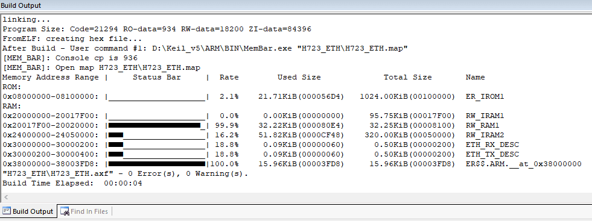
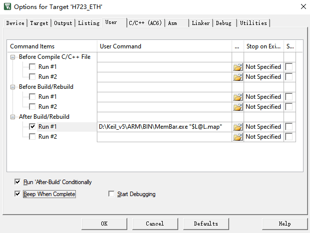

# Keil Memory Bar

## 功能简介

此工具根据Keil编译生成的map文件，获取内存分块的名称，大小，使用量，基地址，绘制成内存占用指示条。



## 使用指南

1. 拷贝MemBar.exe到Keil安装目录下，例如`D:\Keil_v5\ARM\BIN`

2. 点击魔术棒

3. 点击User选项卡

4. 设置After Build/Rebuild执行命令，工具路径设置成实际的路径，建议路径最好不要带空格

   ```bat
   D:\Keil_v5\ARM\BIN\MemBar.exe "$L@L.map"
   ```



## 二次开发

项目内只有一个源码文件`mem_bar.c`，直接使用make命令编译。

`examples`文件夹内包含两个.map文件，一个STM32H750VB，一个CH32V208，可以使用`make example`命令查看效果。

```sh
#克隆项目到本地
git clone https://gitee.com/MoodDream/keil-memory-bar.git
cd keil-memory-bar
#编译源码
make
#测试运行编译后的程序
make example
```

